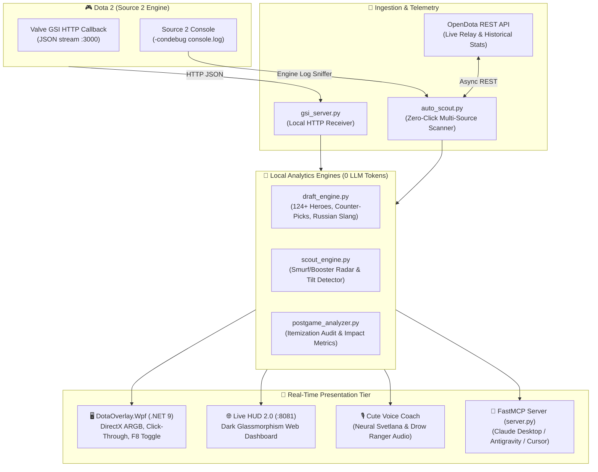

# 🎮 dota2-mcp — Real-Time Dota 2 Telemetry & Tactical Coach

<div align="center">

[](https://python.org)
[](https://dotnet.microsoft.com/)
[](#-100-vac-safe-architecture)
[](https://modelcontextprotocol.io/)
[](#-zero-token-cost-architecture)
[](LICENSE)

<p align="center">
  <b>A legal, read-only analytics powerhouse and real-time companion for Dota 2.</b><br>
  Powered by Valve Game State Integration (GSI), OpenDota telemetry, a native C# .NET 9 click-through DirectX overlay, and the Model Context Protocol (MCP).
</p>

[Key Features](#-key-features) •
[Architecture](#-architecture) •
[In-Game Overlay](#-native-net-9-wpf-in-game-overlay) •
[Quick Start](#-quick-start-windows-powershell) •
[MCP Tools](#-mcp-tools-overview) •
[Comparison](#-why-dota2-mcp-vs-alternatives) •
[License](#-license)

</div>

---

## ⚡ Highlights

- 🛡️ **100% VAC-Safe:** Does NOT inject DLLs, does NOT read or write game memory, and does NOT simulate user input. Operates purely through Valve's official Game State Integration (GSI) HTTP callback pipeline.
- 🎯 **Native C# .NET 9 WPF Overlay:** Zero screen darkening, true Win32 click-through (`WS_EX_TRANSPARENT`), 60 FPS DirectX-accelerated dark glassmorphism, and instant mode switching with global hotkey `F8`.
- 🕵️ **Zero-Click Hands-Free Lobby Scout:** Automatically discovers all 10 players during the draft phase across 4 independent sources (GSI `allplayers`, OpenDota `/api/live`, engine console logs, and clipboard).
- 🚨 **Smurf & Booster Radar:** Evaluates opponents for smurf probability, recent win streaks, winrates, and hero spams (Meepo, Tinker, Huskar, Lone Druid, Arc Warden) with automated ban recommendations.
- 🎙️ **Zero-Token Voice Coach:** Natural neural voice audio cues (`ru-RU-SvetlanaNeural`) and authentic Drow Ranger voice lines for bounty runes, water runes, wisdom runes, Tormentor, and Roshan day/night cycles.
- 🌐 **Live HUD 2.0 Web Dashboard:** Dark glassmorphism telemetry board at `http://localhost:8081` with live base building health grids, hero vitals, and interactive draft counter-pick calculator.
- 🤖 **FastMCP Server for AI Agents:** Seamless integration with Claude Desktop, Antigravity, Cursor, and any MCP host via standard I/O.
- 💰 **Zero Token Cost:** All draft heuristics, smurf detection, counter-picks, and post-game auditing run locally using deterministic algorithmic models.

---

## 🏗️ Architecture



---

## 🖥️ Native .NET 9 WPF In-Game Overlay

The in-game overlay is implemented in C# .NET 9 (`DotaOverlay.Wpf/`) using native Windows Desktop Window Manager (DWM) per-pixel 32-bit ARGB composition:

| Feature | Technical Implementation | Advantage |
| :--- | :--- | :--- |
| **True Click-Through** | Win32 styles `WS_EX_TRANSPARENT \| WS_EX_LAYERED \| WS_EX_NOACTIVATE` | Mouse clicks fall straight through to Dota 2; game never loses focus or input |
| **Zero Screen Dimming** | DirectX hardware composition instead of Tkinter canvas alpha-blending | 100% transparent game view with crisp text and frosted glass badges |
| **Draft Radar Mode** | Activates automatically during `HERO_SELECTION` | Shows 10-player cards: rank medals, winrates, smurf badges, signature hero pools |
| **In-Game HUD Mode** | Activates during `GAME_IN_PROGRESS` and `PRE_GAME` | Compact corner widget: river/bounty/wisdom rune timers, tormentor, roshan, buyback status |
| **Global Hotkey** | Win32 `RegisterHotKey` on `F8` | Instantly toggles: `Auto` ➔ `Timers only` ➔ `Draft only` ➔ `Hidden` |
| **Auto-Lifecycle** | Monitored by `watcher.py` | Automatically boots when `dota2.exe` opens and shuts down on game exit |

---

## 🛡️ 100% VAC-Safe Architecture

Valve Anti-Cheat (VAC) monitors process memory, loaded modules, and system hooks. `dota2-mcp` is designed from the ground up to be **100% compliant with Valve's ToS and VAC integrity guidelines**:

1. **No Memory Reading/Writing:** Never calls `OpenProcess`, `ReadProcessMemory`, or `WriteProcessMemory`.
2. **No DLL Injections:** Never loads foreign libraries into `dota2.exe`.
3. **Official GSI API:** Dota 2 natively pushes JSON state packets to `http://127.0.0.1:3000` via Valve's Game State Integration system (originally designed for tournament broadcasts).
4. **Passive Log Sniffing:** Console information is parsed from Valve's official `-condebug` text file log on disk.
5. **No Automation or Macros:** Does not move the mouse, cast abilities, or click buttons for the player. It is an analytical second brain.

---

## 📊 Why dota2-mcp vs. Alternatives?

| Feature | **dota2-mcp** | Overwolf / DotaPlus App | Steam Dota Plus ($4/mo) |
| :--- | :---: | :---: | :---: |
| **VAC Safety** | ✅ **100% Safe (Official GSI)** | ⚠️ Hook-based / Third-party DLLs | ✅ Native |
| **Performance Overhead** | ✅ **Near-zero CPU, ~30 MB RAM** | ❌ Heavy Chromium/Electron bloat | ✅ Native |
| **In-Game Overlay** | ✅ **Native .NET 9 WPF (DirectX)** | ⚠️ Bloated Web Overlay | ✅ Native |
| **Click-Through & Screen Dimming** | ✅ **100% Click-Through, 0 Dimming** | ❌ Can capture mouse / dim | ✅ Native |
| **Smurf & Booster Radar** | ✅ **Automated (Heuristic scoring)** | ⚠️ Behind paywall | ❌ Not available |
| **Audio Voice Coach** | ✅ **Neural voice (Svetlana / Drow)** | ❌ No / limited | ❌ No |
| **AI / MCP Integration** | ✅ **Full Claude / Antigravity access** | ❌ None | ❌ None |
| **Price & Privacy** | 🆓 **100% Free & Open Source (Local)** | ❌ Ads, analytics, paywalls | ❌ $4.00 / month |

---

## 📦 Project Structure

```
dota2-mcp/
├── server.py                  # FastMCP server implementation (stdio, stdlib-only)
├── gsi_server.py              # Local HTTP receiver for Dota 2 GSI (port 3000)
├── auto_scout.py              # Hands-free multi-channel lobby player discovery
├── scout_engine.py            # Smurf/booster radar & threat assessment engine
├── draft_engine.py            # Draft counter-pick matrix for 124+ heroes + slang
├── postgame_analyzer.py       # Deep post-match audit (KDA, impact, counter-items)
├── live_board.py              # Live HUD 2.0 Web Dashboard (port 8081)
├── live_data.py               # Telemetry aggregation & map timer calculator
├── voice_coach.py             # Neural voice coach (bounty, wisdom, roshan, tormentor)
├── auto_accept.py             # Visual pixel match auto-accept (100% hook-free)
├── watcher.py                 # Master daemon: process supervisor, HUD & overlay lifecycle
├── dota_assistant.pyw         # Silent background launcher (Windows Startup)
├── start_auto.bat             # One-click startup script (GSI + Watcher + Live HUD)
├── start_overlay.bat          # Standalone launcher for WPF overlay
├── DotaOverlay.Wpf/           # C# .NET 9 WPF transparent DirectX overlay project
│   ├── MainWindow.xaml.cs     # Glassmorphism UI, Click-Through Win32 styles, F8 hotkey
│   └── DotaOverlay.Wpf.csproj # .NET 9.0 Windows desktop project
├── overlay_bin/               # Pre-compiled lightweight overlay executable (156 KB)
├── audio_cute/                # Pre-rendered high-quality neural voice cues
├── tools/
│   └── install_gsi.py         # Automated Valve GSI config installer
└── tests/                     # Automated integration and unit test suite
```

---

## 🚀 Quick Start (Windows, PowerShell)

### 1. Installation

```powershell
# Clone the repository
git clone https://github.com/frontys/dota2-mcp.git
cd dota2-mcp

# Optional: create a virtual environment
python -m venv venv
.\venv\Scripts\Activate.ps1

# Install optional dependencies for live dashboard and voice
pip install requests psutil miniaudio
```

### 2. Configure Valve Game State Integration

Run the automatic installer to place `gamestate_integration_mcp.cfg` into your Dota 2 game directory:

```powershell
python tools\install_gsi.py
```

*(Ensure Dota 2 launch options include `-condebug` for the console log sniffer).*

### 3. Launch the Assistant

Run the automated master launcher:

```powershell
.\start_auto.bat
```

Or run individual modules as needed:

```powershell
# Web Live HUD 2.0:
python live_board.py
# Open in browser: http://127.0.0.1:8081

# Native .NET 9 Transparent In-Game Overlay:
.\start_overlay.bat

# Interactive CLI Coach:
python coach_cli.py
```

---

## 🤖 MCP Client Setup (Claude Desktop, Cursor, Antigravity)

Connect `dota2-mcp` to **Claude Desktop**, **Antigravity**, or any MCP-compatible environment. Add the following to your `claude_desktop_config.json`:

```json
{
  "mcpServers": {
    "dota2": {
      "command": "python",
      "args": ["C:\\AI\\dota2-mcp\\server.py"],
      "cwd": "C:\\AI\\dota2-mcp"
    }
  }
}
```

Restart your client. All `dota_*` tools will be available immediately for conversational analysis, live draft advice, and post-match breakdowns.

---

## 🛠️ MCP Tools Overview

| Tool | Parameters | Description |
| :--- | :--- | :--- |
| `dota_gsi_status` | — | Checks GSI server heartbeat and last telemetry packet timestamp |
| `dota_gsi_latest` | — | Fetches live in-game metrics: hero, HP/MP, KDA, GPM/XPM, game time, timers |
| `dota_scout_player` | `player_id` | Full dossier: smurf threat score, winrate, recent hero pool, and ban advice |
| `dota_scout_lobby` | `players` | Scans up to 10 players in parallel from IDs, URLs, or console text |
| `dota_pick_advice` | `enemy_heroes`, `allies` | Full counter-pick engine against 1–5 enemy heroes with item counters |
| `dota_match_details` | `match_id` | Deep post-game breakdown: KDA, kill participation, damage shares, item audit |
| `dota_coach_tip` | `hero_name`, `game_time` | Context-aware coaching advice for the current game state or matchup |
| `dota_hero_stats` | `hero_name` | Hero performance analytics, winrates, and role attributes |
| `dota_item_guide` | `hero_name` | Recommended item progression (Starting ➔ Early ➔ Core ➔ Late) |
| `dota_stratz_match` | `match_id` | Advanced match telemetry via STRATZ GraphQL (requires `STRATZ_TOKEN`) |
| `dota_profile` | `account_id` | Retrieves OpenDota profile: estimated MMR, rank tier, winrate |
| `dota_recent_matches` | `account_id`, `limit` | Lists recent matches with performance statistics and W/L records |
| `dota_launch` | — | Launches Dota 2 via Steam with recommended training options |
| `dota_gsi_install` | — | Verifies and reinstalls the GSI configuration file |

---

## 👥 Authors & Credits

- **Creator & Lead Architect:** [@frontys](https://github.com/frontys)
- **Data Providers:** Valve Game State Integration (GSI) & [OpenDota API](https://www.opendota.com/)

---

## 📄 License

This project is licensed under the [MIT License](LICENSE) — free for personal and commercial use.
